# Yagen's Mobs

Adds new creatures and encounters to Minecraft.

See the [bilingual gameplay guide](GamePlay.md) for creature behavior, controls, recipes, and configuration.

## Installation

Install the JAR in the `mods` directory on the client and server.

| Minecraft | Loader | Java | Additional dependency |
| --- | --- | --- | --- |
| 1.21.1 | NeoForge 21.1.235 | 21 | [GeckoLib 4.9.2](https://modrinth.com/mod/geckolib/version/tPkJmim6) on the client and server |
| 1.21.1 | Fabric Loader 0.20.1 | 21 | Fabric API 0.116.17+1.21.1 and [GeckoLib 4.9.2](https://modrinth.com/mod/geckolib/version/dnJdtm0u) on the client and server |
| 1.21.11 | Fabric Loader 0.20.1 | 21 | Fabric API 0.141.6+1.21.11 and [GeckoLib 5.4.5](https://modrinth.com/mod/geckolib/version/G1BvHQDL) on the client and server |
| 26.3 | Fabric Loader 0.20.1 | 25 | Fabric API 0.165.2+26.3 and [GeckoLib 5.5.7](https://modrinth.com/mod/geckolib/version/kSxHvs99) on the client and server |
| 1.20.1 | Forge 47.3.22 | 17 | [GeckoLib 4.8.5](https://modrinth.com/mod/geckolib/version/dBtjgm8n) on the client and server |

## Desert Skate

Watch for a ripple in desert sand. A school of Desert Skates can swim right under your feet before an adult breaks cover, curls its tail and fires a spine. Drop raw meat or fish to draw one to the surface on your terms. The young trail the adults and slip back under the sand when a fight starts.

<table>
<tr>
<td align="center"></td>
<td align="center"></td>
</tr>
</table>

## Condroc

These savanna scavengers roost in acacias and dive on zombies. Stock a Vulture Post with rotten flesh and the birds will carry blocks between posts. A pair can fly a double chest across the landscape with its contents intact. A Condroc in a bound Mailbag can also fly your finds home while you keep exploring.

<table>
<tr>
<td align="center"></td>
<td align="center"><a href="docs/assets-for-readme/condroc-intro.gif">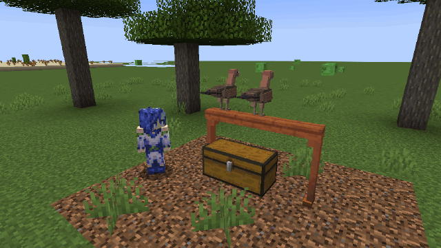</a></td>
</tr>
</table>

## Rock Hanger

Look up in a tall cave and you may spot a Rock Hanger suspended from its own silk, waiting for a spider or an explorer to pass below. Lure it down with a spider eye and shear the exposed silk while it feeds. Wind the silk into spools for the Iron Silk Launcher to rig climbable lines across gaps or down shafts.

<table>
<tr>
<td align="center"><a href="docs/assets-for-readme/rock-hanger-model.png">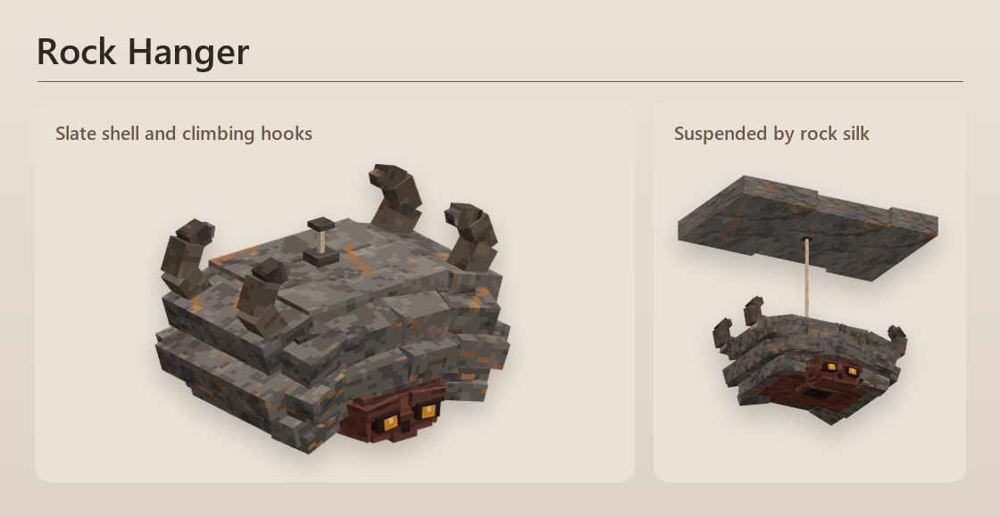</a></td>
<td align="center"></td>
</tr>
</table>

## Bubble Salamander

Tame a Bubble Salamander with raw fish and, once it is grown, slip your head into its bubble underwater. It keeps your air full, grants Night Vision and clears Mining Fatigue so you can mine at your usual speed. The salamander lets go when you surface, and a water bucket makes it easy to bring along on your next dive.

<table>
<tr>
<td align="center"><a href="docs/assets-for-readme/bubble-salamander-model.png">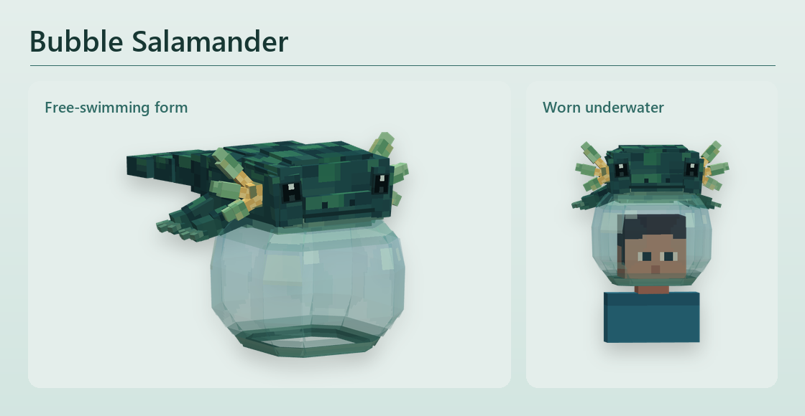</a></td>
<td align="center"><a href="docs/assets-for-readme/bubble-salamander-intro.gif">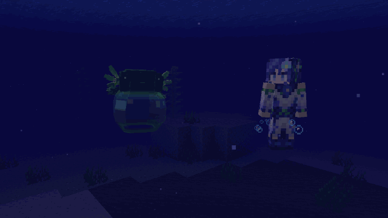</a></td>
</tr>
</table>

[View all coats, ages and sex differences](docs/assets-for-readme/bubble-salamander-variants-en.png)

## Velocipod

Velocipods hunt slimes in the swamps and graze on sugar cane, leaving the roots and planting new stalks nearby. An adult that brings down a large slime can brood a young one. Tame an adult with sugar cane and ride standing on its back. It banks into turns, carries supplies and eats cane from its pack to keep flying.

<table>
<tr>
<td align="center"><a href="docs/assets-for-readme/velocipod-model.png">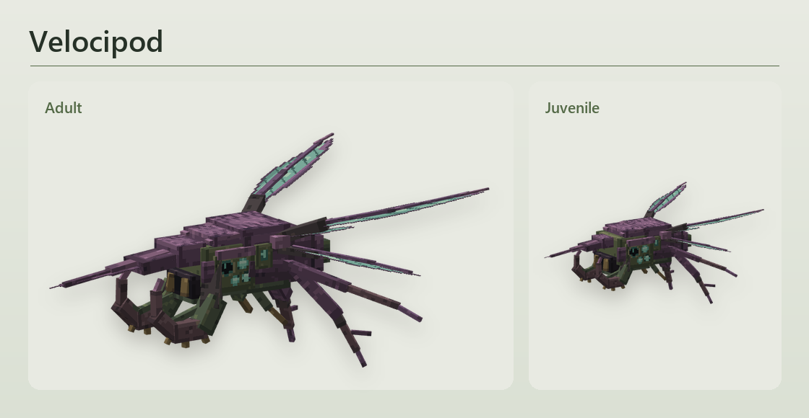</a></td>
<td align="center"></td>
</tr>
</table>

[View all five colors as adults and juveniles](docs/assets-for-readme/velocipod-variants-en.png)

## More creatures

| Creature | What you can discover |
| --- | --- |
| **Lumen Butterfly** | Tame each color with its matching plant and the adults will circle you, gathering experience directly from your kills. You can reclaim what they store or let the flock put it to work. Some colors heal, some help you mine, and breeding all nine lineages into one butterfly produces a rainbow guardian. [Variant gallery](docs/assets-for-readme/lumen-butterfly-variants-en.png) |
| **Salvage Ray** | On the outer End islands, Salvage Rays sweep up loose items and race to catch falling explorers before they reach the void. They bring their finds back to nest boxes. Offer chorus fruit to ride between linked boxes, or enlist a ray to carry a silk line across a gap beyond the launcher’s reach. [Variant gallery](docs/assets-for-readme/salvage-ray-variants-en.png) |
| **Snowcache Weasel** | Give a tamed weasel a storeroom and it will sort deliveries by creative tab, using the first item in each chest as its guide. You can choose which containers it may fill or empty. With JEI installed, hand it a Recipe Blueprint and it will gather ingredients, craft what it can at a crafting table and bring the order back. [Variant gallery](docs/assets-for-readme/snowcache-weasel-variants-en.png) |
| **Kavat** | Breed a feline companion in an incubator using genetic codes or traded imprints. Ears, tails and coat colors are inherited separately from breed. A Smeeta vanishes behind a decoy, an Adarza reflects incoming damage, and a Vasca can spend its own health to save you from a fatal blow. The incubator can revive a lost companion. [Breeds](docs/assets-for-readme/kavat-breeds-en.png) · [Ears](docs/assets-for-readme/kavat-ears-en.png) · [Tails](docs/assets-for-readme/kavat-tails-en.png) · [Coats](docs/assets-for-readme/kavat-coats-en.png) |

## Variant galleries

<table>
<tr>
<td align="center"><a href="docs/assets-for-readme/bubble-salamander-variants-en.png">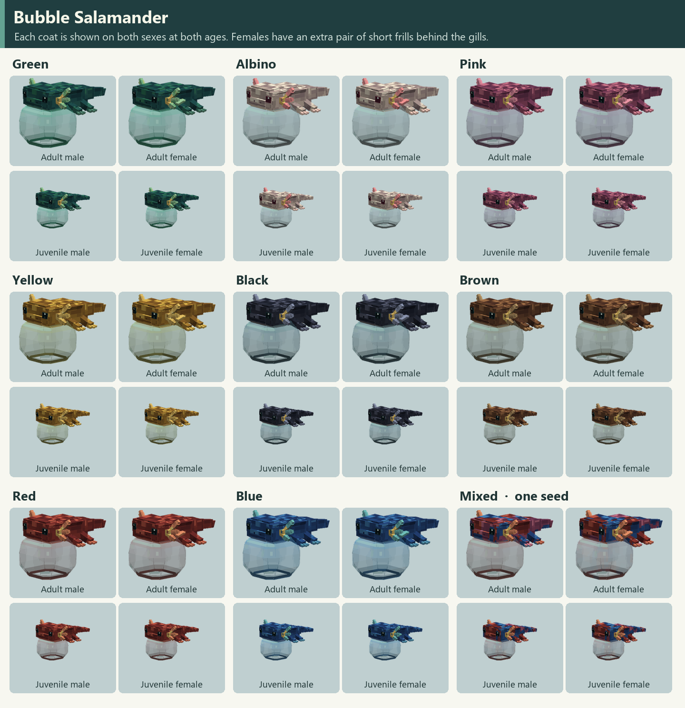</a></td>
<td align="center"><a href="docs/assets-for-readme/velocipod-variants-en.png">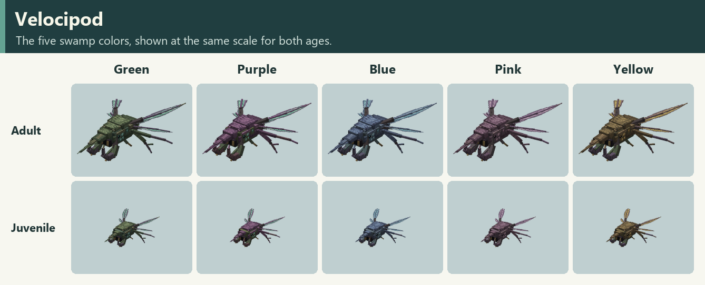</a></td>
</tr>
</table>

<table>
<tr>
<td align="center"><a href="docs/assets-for-readme/lumen-butterfly-variants-en.png">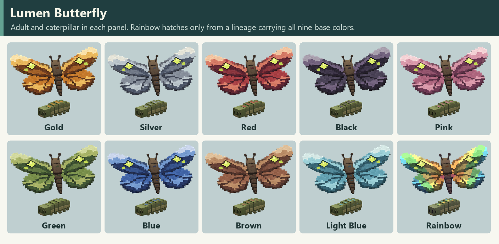</a></td>
<td align="center"><a href="docs/assets-for-readme/salvage-ray-variants-en.png">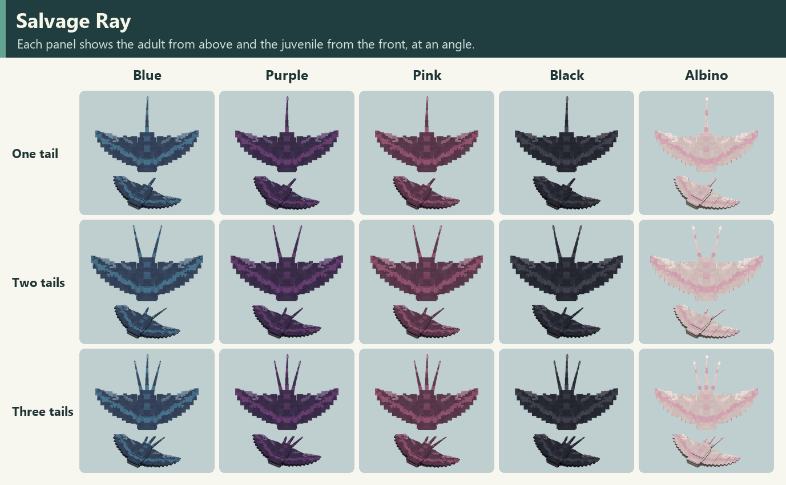</a></td>
</tr>
</table>

<a href="docs/assets-for-readme/snowcache-weasel-variants-en.png">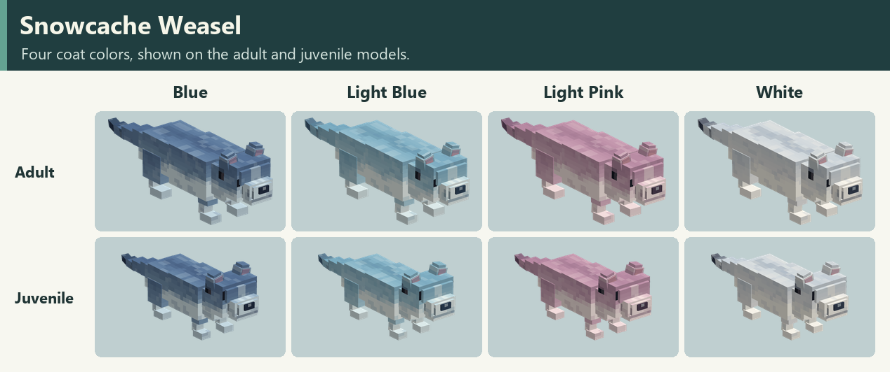</a>

### Kavat traits

<table>
<tr>
<td align="center"><a href="docs/assets-for-readme/kavat-breeds-en.png">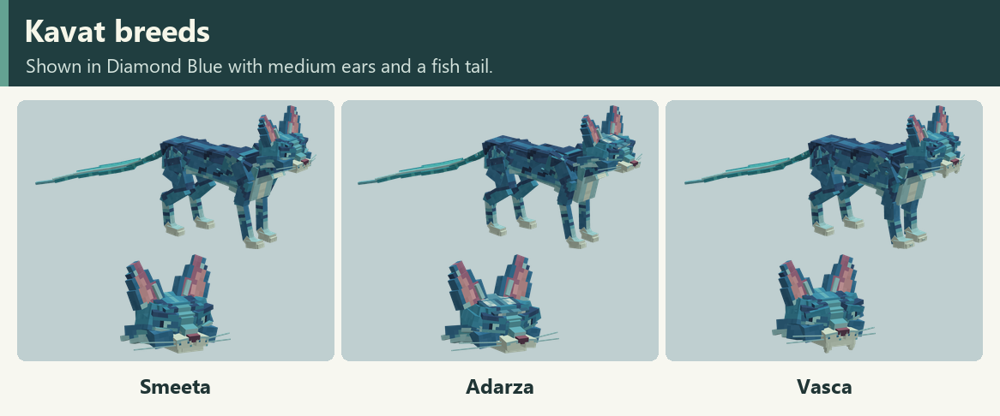</a></td>
<td align="center"><a href="docs/assets-for-readme/kavat-ears-en.png">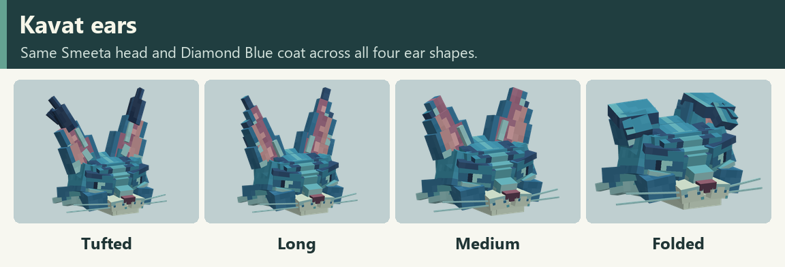</a></td>
</tr>
<tr>
<td align="center"><a href="docs/assets-for-readme/kavat-tails-en.png">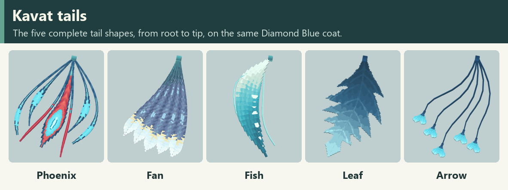</a></td>
<td align="center"><a href="docs/assets-for-readme/kavat-coats-en.png">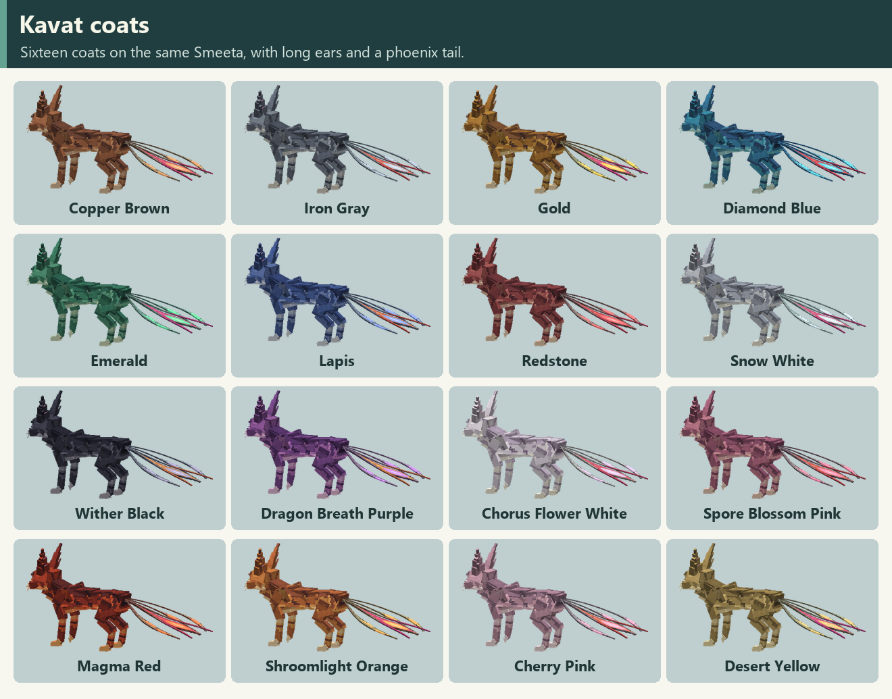</a></td>
</tr>
</table>

## Server configuration

Configure natural spawning in `config/yagens_mobs/yagens_mobs-server.toml`. For a single world, place its override in `serverconfig/yagens_mobs/` and reopen the world or restart the server. The [gameplay guide](GamePlay.md) covers spawn conditions and species-specific settings.

## Changelog

See the [version history](docs/changelog/).

## License

See [LICENSE.md](LICENSE.md).
