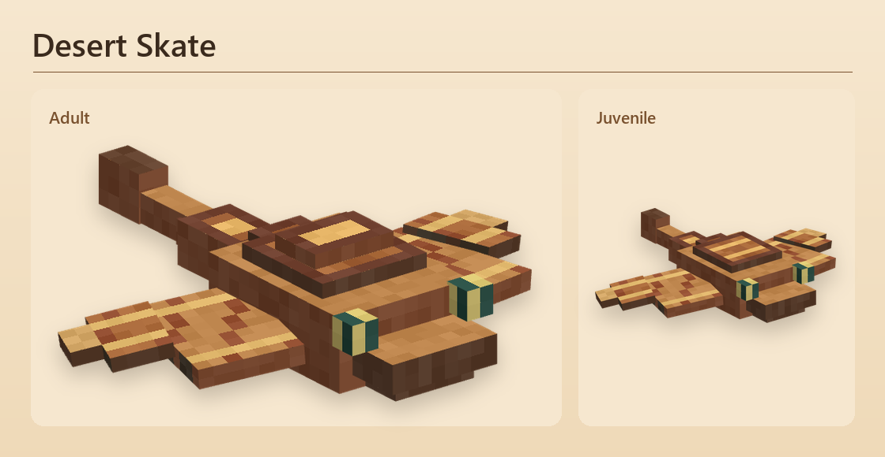
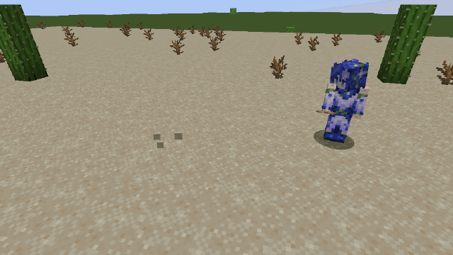
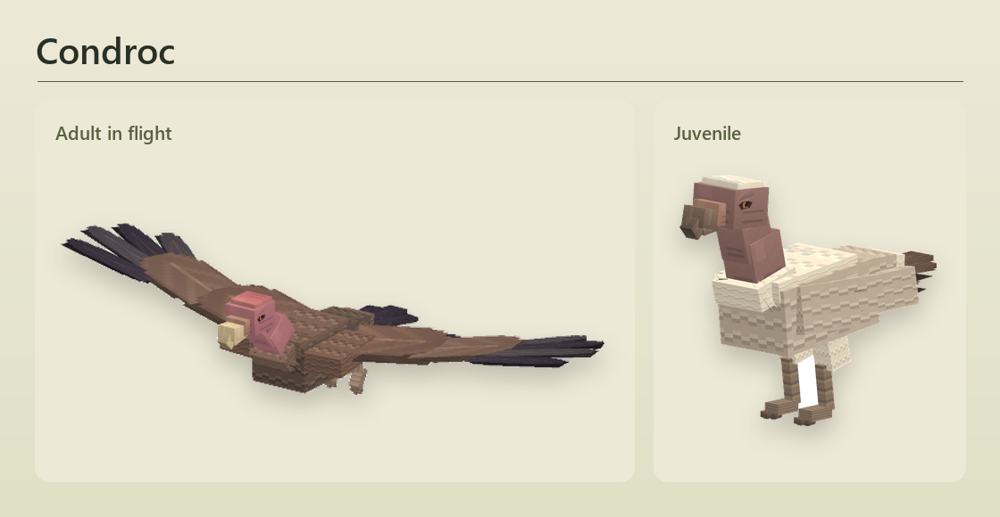
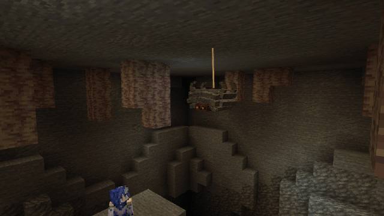
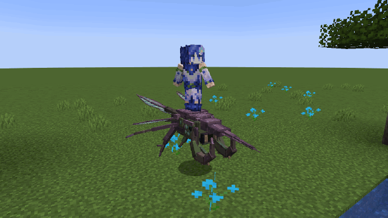

# Yagen's Mobs

Adds new creatures and encounters to Minecraft.

See the [bilingual gameplay guide](GamePlay.md) for creature behavior, controls, recipes, and configuration.

## Installation

Install the JAR in the `mods` directory on the client and server.

| Minecraft | Loader | Java | Additional dependency |
| --- | --- | --- | --- |
| 1.21.1 | NeoForge 21.1.235 | 21 | [GeckoLib 4.9.2](https://modrinth.com/mod/geckolib/version/tPkJmim6) on the client and server |
| 1.21.1 | Fabric Loader 0.20.1 | 21 | Fabric API 0.116.17+1.21.1 and [GeckoLib 4.9.2](https://modrinth.com/mod/geckolib/version/dnJdtm0u) on the client and server |
| 1.21.11 | Fabric Loader 0.20.1 | 21 | Fabric API 0.141.6+1.21.11 and [GeckoLib 5.4.5](https://modrinth.com/mod/geckolib/version/G1BvHQDL) on the client and server |
| 26.3 | Fabric Loader 0.20.1 | 25 | Fabric API 0.165.2+26.3 and [GeckoLib 5.5.7](https://modrinth.com/mod/geckolib/version/kSxHvs99) on the client and server |
| 1.20.1 | Forge 47.3.22 | 17 | [GeckoLib 4.8.5](https://modrinth.com/mod/geckolib/version/dBtjgm8n) on the client and server |

## Desert Skate

Desert Skates spawn in groups of three or four on sand in deserts and badlands. They swim under sand and red sand, leaving a directional wake near the surface. An adult can detect dropped raw meat or fish on sand within 32 blocks and commits to its chosen bait for up to 12 seconds. It swims beneath the food before surfacing to eat. When an unoccupied adult detects a player, rabbit, or villager within four blocks above it, sand gathers around its exit for 12 ticks. It only ambushes the original prey if it is still in range and visible when the warning ends. Digging away the sand containing a skate exposes it at its actual position.

A surfaced skate that spends four seconds without prey or food has a 10% chance per second to dive when it is on sand. Rain drives skates to the surface and keeps them there until the weather clears.

An adult skate has 20 health points, 4 armor, and 2 armor toughness. A hit from above deals 10% of its incoming damage before normal armor calculations at either age. Above ground, adults retreat when their target closes to four blocks. They curl their tail upward before firing a spine from its tip. Spines travel up to eight blocks.

Juveniles follow adults and dive into dry sand when their leader engages prey. They stay below the leader while it fights. They have 10 health points, 0 armor, and 0 armor toughness. A juvenile grows up after 20 minutes of active entity ticks. Each piece of raw meat or fish it eats removes two minutes. Players can also right-click a surfaced juvenile with food.

Raw meat and fish give skates Regeneration II for 30 seconds. Feed a surfaced adult by hand or leave food for it to collect. After eating, an adult can seek a ready mate within 16 blocks for one minute. The pair produces one juvenile when they meet and both enter a 20-minute breeding cooldown.

With mob loot enabled, an adult drops 1–3 Raw Desert Skate. Each level of Looting independently has a 50% chance to add one. A juvenile drops 1–2 with no Looting bonus. Raw meat restores 4 hunger and 2 saturation and can be used as bait. Cook the meat in a furnace, smoker, or campfire for 12 hunger and 12 saturation. Obtaining the cooked meat grants the Juicy Meat advancement.

Optional data files assign 20 water and 10 water saturation to raw meat, and 16 water and 8 water saturation to cooked meat in Thirst Was Taken 2 and Homeostatic. Homeostatic caps the player's water saturation at 5. Tough As Nails uses the same water values and its 20% hydration tier, which grants up to 8 water saturation for raw meat and 6.4 for cooked meat.

Use `/summon yagens_mobs:desert_skate` to spawn an adult manually or `/summon yagens_mobs:desert_skate ~ ~ ~ {GrowthTicks:24000}` to spawn a juvenile.

The Yagen's Mobs creative tab contains the mod's items, with spawn eggs at the end.

## Condroc

Condrocs are most common in savannas and can also appear in deserts, badlands, and open ravines. Adults have 16 health and deal 8 base damage when they dive at zombies. Both ages look for dropped raw meat and rotten flesh. Hand-feed rotten flesh or drop it near two adults to let them breed. A nest holds one to three eggs for five minutes, then hatches the chicks and drops two to four sticks. A chick grows up after 20 minutes of active entity ticks.

Idle adults prefer stocked posts. When no post is available, they can rest on exposed acacia logs or on the canopy directly above a log. Adults on patrol aim for eight to twelve blocks above the local surface and climb before crossing rising terrain.

1. Craft an acacia Vulture Post. Connect more posts along the beam to add one perch and one cargo slot per column. Posts with the same owner and orientation form a continuous beam with supports at the two ends.
2. Right-click with rotten flesh to stock the station, or use the bulk deposit button for your inventory. A connected station holds 65,536 rotten flesh across its columns. Idle adults can land at stocked stations and consume one flesh apiece every ten minutes.
3. Right-click a lower slot with a block to stage it. Use empty Cargo Tongs on a placed chest, furnace, bed, or other supported functional block to keep its state and stored contents. For a larger structure, sneak-use empty tongs on two opposite corners of a selection up to 64 cells. Then right-click a lower slot with the loaded tongs.
4. Right-click the upper beam to see stations in the same dimension. The owner can rename the station, change its listing visibility, and set whether its birds return after delivery. Hover a destination to see which stations reserved its cargo space. Selecting an available destination dispatches the staged load using one perched adult per block.
5. Retrieve an ordinary staged block with sneak-right-click. For functional or multi-block cargo, use empty tongs while sneaking, then right-click a suitable spot in the world to put the cargo down.

Shipping costs one rotten flesh per bird for each started 100 blocks. Deliveries reserve cargo space immediately and do not require free destination perches. Each double chest uses two adjoining cargo slots. The flock climbs while flying forward, then cruises at four blocks per second with at least 24 blocks of terrain clearance. In open air it glides down one block per minute and regains two blocks with one wingbeat after about two minutes. It climbs earlier when terrain requires it. A killed carrier brings the shipment down. The sender receives the coordinates once the cargo has been placed. If there is no room to place an intact load, recovery keeps trying in the area. Captured modded machines retain their saved block data, but block networks that store connections or inventories outside the selected blocks can require reconnecting at the destination.

Transport jobs temporarily force-load the chunks needed for the outbound flight, optional return, and final perching or cargo recovery. Condrocs use normally loaded chunks during patrol and other wildlife behavior.

During active cargo flight, the server measures the flock's displacement every 20 ticks. Three consecutive measurements of two blocks or less trigger a local detour search. Waiting for loaded chunks does not advance the measurement window. Detour edges check the birds and suspended cargo together and preserve the formation while flying the route.

Adult condrocs drop one or two Flight Feathers. Each level of Looting has an independent 50% chance to add one. A feather and five leather craft a Mailbag with 27 slots. Use it on an owned station to bind it and load a perched adult. Open the bag anywhere and select Send Home to fly it back to the bound station in the same dimension without spending rotten flesh. The bird searches for a passable route out of enclosed terrain before launch. Retrieve delivered bags through the station's Collect Mail button.

## Rock Hanger

Rock Hangers spawn under suitable ceilings in ordinary, dripstone, and lush caves. They hang from a strand of Rock Silk and strike at players and spiders that pass beneath them. When knocked down, they can climb a wall and cross the ceiling to hang again.

Drop a spider eye underneath one to lure it down. Eating the eye fully heals it. While it feeds, use shears on its exposed tuft to collect two Rock Silk. You can also cut the hanging strand with shears to drop the creature and collect one Rock Silk if you have yet to shear its tuft during that feeding.

Use Rock Silk Spools with an Iron Silk Launcher to rig a climbable line between two rock pins or let the line hang from a single pin. The launcher previews which faces can hold a pin. Right-click the line to grab it, then use your movement keys to climb. Jump or sneak to let go.

## Bubble Salamander

Bubble Salamanders live in rivers and warm or lukewarm oceans. Feed one three raw fish to tame it. Submerge yourself, take off your helmet, and right-click your tamed adult with an empty hand to wear its bubble. You can carry a Bubble Salamander in a water bucket.

The bubble keeps your air full, improves underwater visibility, and removes the underwater mining penalty and Mining Fatigue. Your companion detaches when your head breaks the surface. Press **B** to remove it underwater.

Tamed adults can breed with raw fish in suitable water, such as a river. Juveniles come in the same colors as adults and can be worn once they grow up.

## Velocipod

Velocipods live in swamps and mangrove swamps. They hunt slimes and eat sugar cane, leaving the bottom stalk intact and looking for a place to replant it. An adult that kills a large slime can find a safe spot to brood and produce one juvenile.

Each piece of sugar cane has a 20% chance to tame a Velocipod. Right-click your tamed adult with an empty hand to ride it standing up. Use **WASD** to walk at 5 blocks per second and **Space** to take off. Cruise at 12 blocks per second or hold your sprint key to fly at 36. The Velocipod banks with you as you turn and beats its wings faster when sprinting.

The stamina bar appears in the experience bar's place. Sprinting requires at least 30% stamina. Stamina recovers while hovering or moving slowly in the air and recovers faster on the ground. Sugar cane restores 50 points. The Velocipod eats sugar cane from its backpack when stamina drops below 50%. Open its 27-slot backpack with sneak-right-click or press **E** while riding.

The rear camera pulls back as you gain speed in vanilla third person and in the free and fixed views from Ninjas Free Play. Set `velocipodMaxCameraPullback` in `config/yagens_mobs/yagens_mobs-client.toml` to choose the maximum extra distance. The default is 4 blocks. Use 0 to disable the effect.

## More creatures

| Creature | Description |
| --- | --- |
| Lumen Butterfly | A tameable butterfly that stores experience and grants abilities based on its color. |
| Salvage Ray | A ray from the outer End islands that retrieves falling items and carries players between nest boxes. |
| Snowcache Weasel | A tameable snow weasel that sorts chests and gathers materials from JEI recipe blueprints. |
| Kavat (NeoForge 1.21.1) | Incubate a feline companion from genetic codes or traded imprints, inherit its breed ability, and revive it from its owner's memories. |

## Server configuration

Edit `config/yagens_mobs/yagens_mobs-server.toml`. To override the instance settings for one world, place the file under that world's `serverconfig/yagens_mobs/` directory. Restart the server or reopen the singleplayer world to apply spawn changes.

| Key under `[spawns.desert_skate]` | Default | Effect |
| --- | --- | --- |
| `enabled` | `true` | Allows natural spawning. |
| `weight` | `2` | Relative selection weight in the biome's monster pool. Setting it to zero disables natural spawning. |
| `minGroupSize` | `3` | Minimum number of attempts for a selected group. |
| `maxGroupSize` | `4` | Maximum group size. Values below the minimum use the configured minimum. |
| `juvenileChance` | `0.25` | Chance that each member after the first in a natural group is a juvenile. |

Terrain and mob caps can reduce the number that successfully spawn. Spawn settings apply to new natural spawns. Datapacks can extend the biome, burrowable-block, bait-item, and prey-entity tags.

The same keys apply under `[spawns.condroc]`. Defaults are `enabled = true`, `weight = 8`, group size 1–3, and `juvenileChance = 0.20` per eligible condroc. The weight is for the savanna creature pool. Datapack modifiers scale it down in the desert and badlands and apply a smaller weight at eligible open ravines.

Rock Hangers, Bubble Salamanders, and Velocipods each have their own `enabled`, `weight`, `minGroupSize`, and `maxGroupSize` settings.

| Section | Default weight | Default group size |
| --- | --- | --- |
| `[spawns.rock_hanger]` | 10 | 1 |
| `[spawns.bubble_salamander]` | 5 | 1–2 |
| `[spawns.velocipod]` | 6 | 1–2 |
| `[spawns.snowcache_weasel]` | 6 | 1–2 |

`minimumAirBelow` under `[spawns.rock_hanger]` sets the required clearance beneath a ceiling. It defaults to 16 blocks and also applies to ceiling placement with spawn eggs and reattachment.

## Changelog

See the [version history](docs/changelog/).

## License

See [LICENSE.md](LICENSE.md).
